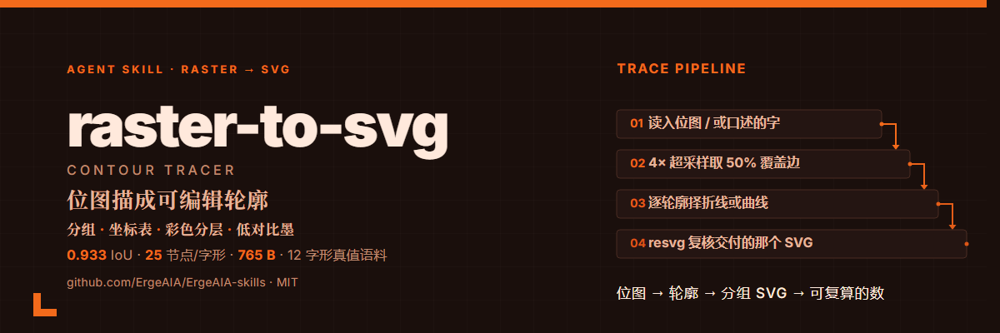

# raster-to-svg



**Turns an image or a few words into an editable SVG.** Not a raster in a vector wrapper: grouped contours you can still edit, exportable coordinates, and a fidelity number computed by rasterising what you ship with a **real renderer**.

```bash
npx skills add https://github.com/ErgeAIA/ErgeAIA-skills --skill raster-to-svg
```

**v0.1.0** · Agent Skill | [中文](README.md) · [CHANGELOG](CHANGELOG.en.md) · **English**

> A raster tracer: take the edge, make the line. Straight stays straight, curved stays curved — and the result can still be edited.

## What it solves

"PNG to SVG" sounds like one conversion; it is three different problems: keep the right angles, restore the curves, separate the colours. Most tools are good at exactly one — you get one giant path (uneditable), a filled-in counter (the hole in 口), or a half-pixel shaved off every thin stroke.

raster-to-svg splits it into three measurable steps:

1. **Where the edge is** — the 50%-coverage iso-line of the grey image at 4x supersampling, not the outer edge of thresholded pixels. The latter is inset by half a pixel, which erodes thin strokes all the way round.
2. **Which engine** — every contour is fitted twice (polyline and cubic), and the engine with the smaller measured deviation wins. Right angles and curves can live in the same drawing.
3. **Why we say it looks right** — the **shipped SVG file** is rasterised by resvg / rsvg-convert and compared with the source (IoU and ink ratio). With no renderer present the tool marks `surrogate_metric` and refuses to present the proxy as fidelity.

The output is not "an image": it is **an editable vector plus a number you can recompute**.

## Quick start

### Install

```bash
npx skills add https://github.com/ErgeAIA/ErgeAIA-skills --skill raster-to-svg
```

### Requirements

| You want to | You need |
| --- | --- |
| trace (required) | Python ≥ 3.10 + `numpy` + `opencv-python-headless` + `pillow` (the renderer path decodes with PIL; without it `--check` can only warn) |
| type the words (`--text`) | a font file (a system CJK font is used when `--font` is omitted) |
| a trustworthy fidelity number | `resvg-py` (pip) or `rsvg-convert` (binary), either one |
| only the SVG, numbers optional | skip the renderer; output is marked `surrogate_metric: true` |

### Run one

```bash
# from an image
uv run --with numpy --with opencv-python-headless --with pillow --with resvg-py \
  python scripts/raster2svg.py -i tests/fixtures/kou_96.png -o /tmp/out --check

# from typed words: render the font first, then trace (no image needed)
uv run --with numpy --with opencv-python-headless --with pillow --with resvg-py \
  python scripts/raster2svg.py --text "开源" --size 160 -o /tmp/out
```

Three stdout lines are the judgement: `components` (how many glyphs), `iou_rendered` (real rendered IoU), `ink_ratio` (ink area ratio). Every run also drops a `<name>.html` — a self-contained interactive report (wheel zoom, 对比 / 源图 / 矢量 / 差异 views, per-component toggles, node overlay, coordinate table with hover highlight). Double-click to open.

## How to use

Find your situation on the left; the right-hand prompt can be pasted to an agent as is.

| Scenario | The one-line point | Copyable example prompt |
| --- | --- | --- |
| Only words, no image | `--text` renders the font, then traces; never hand-draw outlines | "Turn the characters 开源 into an SVG, using Source Han Sans" |
| Glyph / logo to editable SVG | Start with `auto`, read `ink_ratio` before touching anything | "Trace this glyph image into SVG, keep the right angles, one group per character" |
| Pick a font before tracing | open the font studio, preview in CSS, generate only when happy | "show me the CJK fonts I have and use this one" |
| Want a report you can also edit | `<name>.html` now changes colours, drags nodes, adjusts spacing and exports SVG | "Give me a page where I can click through the result" |
| Only the outline coordinates | Ship `_coords.json`, not just the SVG | "Export the vertex coordinates and interior angles; I need to rebuild from them" |
| Flat-colour icon to vector | Start at `--colors 6`, check `_check.png` layer by layer | "Convert this icon to SVG in 6 colour layers, don't chew off the rounded corners" |
| Can this photo be vectorised? | Answer "no, not losslessly" first, then offer posterisation or embedding | "Can this photo become a vector? I need print quality" |
| A source file already exists | With a font or original SVG, do not trace | "This PNG came out of Illustrator, but I still have the SVG — do we trace?" |

## Boundaries (honest ones)

- **Outlines only, never text.** No OCR, no font identification. If the text has to stay editable, go back to the font and the source file.
- **A photo cannot be vectorised losslessly.** SVG regions are piecewise constant; a photo is continuous tone. `--colors` posterises. Three routes: keep the raster, accept posterisation as a style, embed it as `<image>` (not vector data). How close posterisation gets is measured: on real photos, K=16 gives 31.8 / 27.4 dB here versus vtracer's 22.3 / 15.8 dB.
- **For pure mono outlines, potrace is better.** Official potrace 1.16 reaches 0.957 IoU on the same 12 reference glyphs (0.933 here) and is 10-100x faster. Use this skill when you need what potrace cannot emit: grouped editable SVG, vertex/control-point coordinate tables, low-contrast ink (grey text, watermarks — potrace's fixed 0.5 threshold returns an **empty file**, this tool traces it at 0.94), or colour layers.
- **Thin strokes have a floor.** Below 2 px in the source, the trace distorts; upscale the source first.
- **Layout is assumed horizontal, single line.** `--gap` groups by horizontal gap; vertical, multi-line and rotated layouts are not covered (see `references/evidence.md` §6).
- **Colour layers get no subpixel treatment but do get supersampling** (36.66 dB on the 5-colour icon at K=6). `--colors` chases quantisation label edges, where antialiasing is unreadable; `--ss` still runs, closing the half-pixel seams between layers.
- **Text-dense UI screenshots are not its home ground.** The 8-image synthetic corpus and 3 real pages (Chromium, 900×560) agree: this version trails vtracer by 1.3-3.5 dB. **What you get in exchange** is 5-10 paths / 7-49 KB against vtracer's 348-738 paths / 276-631 KB — pick vtracer for "looks like", this one for "still editable", the raster for "identical".
- **Raising K is not raising accuracy.** On real screenshots K=12 is often worse than K=6 (`ui_browser` 22.37 → 20.02): k-means slices antialiased gradients into thin layers, which the area and corner rules then eat.

## Measurements (12 reference glyphs, IoU against a resvg render)

| Tool | Mean IoU | Worst IoU | Mean nodes |
| --- | --- | --- | --- |
| First draft (polygon default) | 0.772 | 0.617 | 27 |
| First draft (curve) | 0.533 | 0.295 | 25 |
| **This version (auto)** | **0.933** | **0.894** | **25** |
| vtracer 0.6.15 polygon | 0.913 | 0.856 | 35 |
| vtracer 0.6.15 spline | 0.912 | 0.852 | 50 |

Colour mode (8-image corpus, PSNR at K=6): flat icon 36.7, line icon 30.1, holes 33.1, gradients 28.3-28.9; badge 24.4, UI panel 24.4, dense UI 25.4 (vtracer is 0.2-3.9 dB ahead on the last three). Corpus mean 28.9 dB here versus 26.5 dB for vtracer, with files 5-10x smaller.

Corpus, method, per-sample wins/losses and what was **not** tested: `references/evidence.md`.

## Files

Outputs per run:

| File | Content |
| --- | --- |
| `<name>.svg` | editable vector: `<g id>` per group, one `<path id="cNN">` per component (holes included) |
| `<name>.html` | self-contained interactive report **and editor**: four views, zoom/pan, component toggles, draggable nodes, per-part colours (picker / hex / preset palette), letter-spacing / simulated weight, undo/reset, SVG export |
| `<name>_coords.json/.txt` | vertices + interior angles, or cubic control points (mono only) |
| `<name>_check.png` | source \| render \| diff, three-up |
| `<name>_diff.png` | the diff plate (red = lost ink, green = added) |
| `<name>_overlay.png` | traced outline and nodes over the source |
| `<name>_source.png` | `--text` only: the rasterised text that was traced |

```
raster-to-svg/
├── SKILL.md                  agent execution rules
├── README.md                 Chinese README
├── README.en.md              this file
├── CHANGELOG.md              Chinese changelog
├── CHANGELOG.en.md           English changelog
├── assets/                   banner.svg (source of truth) / .png / .json / render.md (render recipe)
├── references/
│   ├── parameters.md         flag semantics, tuning criteria, what not to do
│   └── evidence.md           corpus, metrics, before/after, untested items
├── scripts/raster2svg.py     the tracer (CLI)
└── tests/
    ├── test_raster2svg.py    16 self-checks
    ├── tools/                gen_colour_corpus.py (8-image colour corpus generator)
    └── fixtures/             口 96 / 之 128 / flat icon / 60% grey glyph
```

## Version

- **v0.1.0** — first release. The version is kept in sync in `metadata.version` of `SKILL.md`, this file, and the top of `CHANGELOG.md`.
