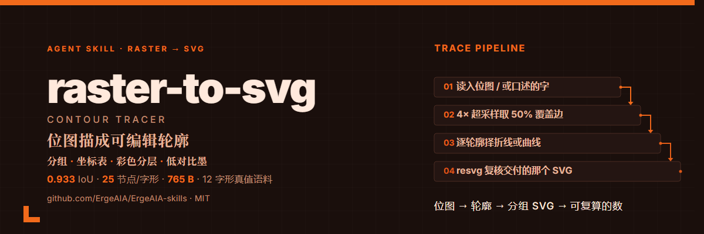

# raster-to-svg



**把一张图或几个字，变成能改的 SVG。** 不是一张糊着的位图外套，是分组可编辑的轮廓、能导出的坐标表，外加一个用**真渲染器**渲你交付件算出来的保真分。

```bash
npx skills add https://github.com/ErgeAIA/ErgeAIA-skills --skill raster-to-svg
```

**v0.1.0** · Agent Skill ｜ [English](README.en.md) · [CHANGELOG](CHANGELOG.md)

> 栅格描摹者，取其边以为线。直者还直，曲者还曲，成器而后可改。

## 解决什么

「PNG 转 SVG」听起来是一个转换，实际是三件不同的事：保住直角、还原曲线、分出颜色。多数工具只在其中一件上像样：转出来的 SVG 要么是一个巨型单路径（没法编辑）、要么把 `口` 的内腔填成实心、要么为了贴边把细笔画削掉半个像素。

raster-to-svg 把这件事拆成可量的三步：

1. **边界从哪来**——读灰度的 50% 覆盖率等值线（4 倍超采样），而不是阈值化像素的外沿。后者天然内缩半像素，细笔画会整圈掉墨。
2. **用哪个引擎**——每条轮廓各拟合一次折线与曲线，按实测最大偏差选，直角与曲线可以同图共存。
3. **凭什么说像**——把**要交付的那个 SVG 文件**交给 resvg / rsvg-convert 栅格化，与源图比 IoU 与墨量比；渲染器不在场时明确标注 `surrogate_metric`，不许把代理分当保真度。

产出不是「一张图」，是**能改的矢量 + 可复算的数**。

## 快速开始

### 安装

```bash
npx skills add https://github.com/ErgeAIA/ErgeAIA-skills --skill raster-to-svg
```

### 前置条件

| 要做的事 | 要求 |
| --- | --- |
| 描摹（必需） | Python ≥ 3.10 + `numpy` + `opencv-python-headless` + `pillow`（渲染器解码走 PIL；没有它 `--check` 只能给代理警告） |
| 直接给词语（`--text`） | 需要一个字体文件（不传 `--font` 时用系统 CJK 字体） |
| 要一个可信的保真度数字 | `resvg-py`（pip）或 `rsvg-convert`（二进制），二选一 |
| 只要 SVG 不在乎数字 | 可以不装渲染器，但输出会标 `surrogate_metric: true` |

### 跑通一条

```bash
# 给一张图
uv run --with numpy --with opencv-python-headless --with resvg-py \
  python scripts/raster2svg.py -i tests/fixtures/kou_96.png -o /tmp/out --check

# 只给几个字：直接渲染字体再描（不需要先找图）
uv run --with numpy --with opencv-python-headless --with pillow --with resvg-py \
  python scripts/raster2svg.py --text "开源" --size 160 -o /tmp/out
```

stdout 三行是判据：`components`（几个字形）、`iou_rendered`（真渲染 IoU）、`ink_ratio`（墨量比）。跑完会多出一份 `<name>.html`——自包含的可交互报告（滚轮缩放、对比/源图/矢量/差异四视图、按部件开关、节点叠印、坐标表悬停高亮），双击即可看。

## 怎么用

从左列找到你手上这种情况，右列那句话可以直接发给 agent。

| 场景 | 一句话要点 | 可复制示例提示词 |
| --- | --- | --- |
| 只给词语，没有图 | `--text` 渲染字体再描，别手画轮廓 | 「把『开源』两个字做成 SVG，用思源黑体」 |
| 字/logo 转可编辑 SVG | 用默认 `auto`，看 ink_ratio 再决定调什么 | 「把这张字图描成 SVG，直角保持住，每个字一个组」 |
| 要一份能看的报告 | 默认已生成 `<name>.html`，可直接发给别人 | 「跑完给我一份能交互看结果的页面」 |
| 只要轮廓坐标 | 交付 `_coords.json`，别只给 SVG | 「导出这些字形的顶点坐标和内角，我要拿去重建」 |
| 平色图标转矢量 | `--colors 6` 起，逐层看 `_check.png` | 「这个图标转 SVG，颜色分 6 层，别把圆角啃掉」 |
| 判断照片能不能矢量化 | 先答「不能无损」，再给海报化或嵌图两条路 | 「这张照片能转成矢量吗？我要印刷级」 |
| 已有源文件时 | 有字体/原始 SVG 就不要描摹 | 「这是从 AI 导出的 PNG，但我有原始 SVG——还要描吗？」 |

## 能力边界（如实）

- **只出轮廓，不出文字**。不做 OCR、不认字体；想要可改的字，请回到字体与源文件。
- **照片不能无损矢量化**。SVG 区域是分段常色，照片是连续调；`--colors` 是海报化。三条路：留位图、接受海报化、嵌 `<image>`（不是矢量数据）。海报化能多接近有数：真实照片 K=16 本版 31.8 / 27.4 dB，vtracer 默认 22.3 / 15.8 dB。
- **纯单色轮廓，potrace 比它强**。官方 potrace 1.16 在 12 个真值字形上 0.957 IoU（本版 0.933），还快 10-100 倍。要用本技能，是因为你要的是 potrace 给不了的东西：分组可编辑的 SVG、顶点/控制点坐标表、低对比墨（灰字、水印——potrace 固定 0.5 阈值会**空输出**，本版 0.94）、彩色分层。
- **细笔画有下限**。源图里笔画 < 2px 时，追踪结果会失真，先放大源图再说。
- **排版假设是横向单行**。`--gap` 按横向间距分组，竖排/多行/旋转未覆盖（见 `references/evidence.md` 第 6 节）。
- **彩色层不享受亚像素，但吃超采样**（K=6 时 5 色图标 36.66 dB）。`--colors` 追的是量化标签边界，没有抗锯齿可读；`--ss` 仍在生效，作用是把层间半像素缝隙压掉。
- **文字密集的 UI 截图不是它的主场**。合成 8 图与 3 张真实页面（Chromium 渲染，900×560）都指向同一结论：本版落后 vtracer 1.3-3.5 dB。**换来的另一头**是 5-10 条路径 / 7-49 KB，而 vtracer 是 348-738 条路径 / 276-631 KB——要「像」选 vtracer，要「能改」选这里，要原样就留位图。
- **调大 K 不等于提精度**。真实截图上 K=12 常比 K=6 更差（`ui_browser` 22.37 → 20.02）：k-means 会把抗锯齿渐变切成薄层，薄层随后被面积与角点规则吃掉。

## 实测（12 个真值字形，resvg 渲染比 IoU）

| 工具 | IoU 均值 | IoU 最差 | 节点均值 |
| --- | --- | --- | --- |
| 初稿（polygon 默认） | 0.772 | 0.617 | 27 |
| 初稿（curve） | 0.533 | 0.295 | 25 |
| **本版（auto）** | **0.933** | **0.894** | **25** |
| vtracer 0.6.15 polygon | 0.913 | 0.856 | 35 |
| vtracer 0.6.15 spline | 0.912 | 0.852 | 50 |

彩色模式（8 图语料，PSNR / K=6）：平色图标 36.7、线条图标 30.1、孔洞图 33.1、渐变 28.3-28.9；徽章 24.4、UI 面板 24.4、密集 UI 25.4（后三者 vtracer 高 0.2-3.9 dB）。8 图均值本版 28.9 dB vs vtracer 26.5 dB，文件小 5-10 倍。

语料、方法、逐样本胜负与「明确没测的」都在 `references/evidence.md`。

## 文件地图

跑完的产物（每个输入一套）：

| 文件 | 内容 |
| --- | --- |
| `<name>.svg` | 可编辑矢量：每组 `<g id>`，每部件一条 `<path id="cNN">`（含孔洞） |
| `<name>.html` | 自包含交互报告：四视图、缩放平移、部件开关、节点叠印、指标卡、坐标表 |
| `<name>_coords.json/.txt` | 顶点/内角或三次控制点（单色模式） |
| `<name>_check.png` | 源图 \| 渲染 \| 差异三联 |
| `<name>_diff.png` | 差异图（红=丢墨，绿=多墨） |
| `<name>_overlay.png` | 轮廓与节点叠在源图上 |
| `<name>_source.png` | 仅 `--text`：渲染出来的字图（也就是被描的那张） |

```
raster-to-svg/
├── SKILL.md                  Agent 执行规则（中文）
├── README.md                 本文件
├── README.en.md              English README
├── CHANGELOG.md              中文变更记录
├── CHANGELOG.en.md           English changelog
├── assets/                   banner.svg / .png / .json
├── references/
│   ├── parameters.md         参数语义、调参判据、别做的事
│   └── evidence.md           语料、指标、前后对照、未测项
├── scripts/raster2svg.py     追踪器（CLI）
└── tests/
    ├── test_raster2svg.py    16 条自检
    ├── tools/                gen_colour_corpus.py（8 图彩色语料生成器）
    └── fixtures/             口 96 / 之 128 / 平色图标 / 灰字 60%
```

## 版本

- **v0.1.0** — 首次发布。版本号在 `SKILL.md` 的 `metadata.version`、本文件、`CHANGELOG.md` 顶部三处对齐。
