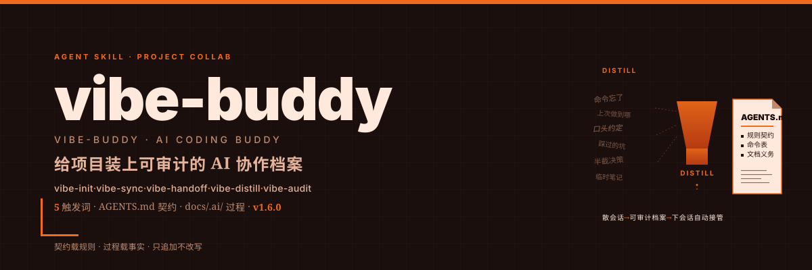

# vibe-buddy

> [中文](README.md) · English

<p align="center">
  
</p>

> A project-side companion for the whole AI coding loop: contracts live in `AGENTS.md`, progress and decisions in `docs/agents/`, and handoffs in `docs/handoff/` — so the next session can pick up where this one left off.

## What it solves

Every new session, the AI asks the same questions: what commands does this project use, what pitfalls exist, where did we stop? Answering them eats half the context.

vibe-buddy turns those answers into files:

- **Contract** — `AGENTS.md`: what you may do, which commands to use, which conventions to follow, and which documents to sync after a task; auto-loaded each session.
- **Progress and decisions** — `docs/agents/`: live progress, a decision log that outranks PRDs, root causes filed separately, append-only.
- **Handoff** — one self-contained document under `docs/handoff/` so another agent can take over without reading the conversation history.

It manages **one project's** collaboration state, not the agent's own memory: every artifact lands inside the project; runtime memory directories and cross-project knowledge bases are never touched.

## Nine triggers

| Trigger | Say it like this | What it does |
|---|---|---|
| `vibe-init` | Initialize this project / generate AGENTS.md | Checks Git (runs `git init` if absent), builds a codegraph index if needed, creates `AGENTS.md` and the full `docs/agents/` set plus `docs/handoff/`; migrates an existing `CLAUDE.md` into `AGENTS.md` and deletes the source only after verification; for half-initialized projects, preserves existing decisions first and fills only what is missing; emits an initialization report; delegates `.gitignore` / `CHANGELOG.md` / `README.md` to git-manager / changelog-manager / shuxu and verifies. |
| `vibe-sync` | Sync progress / update project progress | Writes task state and verification results to `project-progress.md` (with a machine-readable ledger line), decisions to `decision-log.md`, root causes to `debug-log.md`, and fills the `Toolchain` / `Commands` tables in `AGENTS.md` when needed; archives before writing past a threshold. |
| `vibe-handoff` | Hand off context / write a handoff | Creates `docs/handoff/handoff-YYYY-MM-DD[-slug].md`: expands only the four kinds of information unavailable elsewhere (verification status, next focus, blockers and failed paths, pending decisions), points to everything else; archives by quarter past 30 files. |
| `vibe-distill` | Distill experience | Extracts practices that held repeatedly into domain-organized entries (claim / scope / why / how / counter-example, tiered 🔴🟡🟢) under `docs/agents/experience/`. |
| `vibe-audit` | Review the project / review the stack / review this change / security only | Read-only review of development projects: four-dimension full audit, changeset mode (only files changed this round), `mode=security` (security checklist only); report lands in `docs/agents/audit/`; every finding carries `path:line`; Skill projects go to skill-workshop. |
| `vibe-check` | Check up the archive / are docs stale / is numbering broken | **Read-only** checkup: `AGENTS.md` structure and size, broken `References`, stale `updated`, numbering gaps, dual-ledger mismatch, oversized artifacts; every issue comes with evidence and a fix entry point; **writes no files**. |
| `vibe-release` | Check before release / record this release | Release governance contract: six gates (preflight → version decision → archive → commit and tag → rollback point → release record), any single gate can run alone; **no commit / tag / push, no CHANGELOG writes**. |
| `vibe-req` | Clarify a requirement / write it as requirements / EARS | Uses **four elevation questions** to deepen a casual request, then EARS' five sentence patterns (U/E/S/O/U*) to produce testable items; **no relentless questioning, no dev task, no file writes**. |
| `vibe-wrap` | Wrap up the session | After one self-review, runs in sequence: `vibe-sync` → `vibe-distill` only with a second fact source → `vibe-handoff` only when switching sessions; skipped artifacts carry reason codes; no per-item prompting. |

## How to use it

vibe-buddy manages one project's collaboration archive: initialize the contract, sync progress and decisions, write handoffs, distill experience, and review read-only. Each row below is something you would actually say:

| Scenario | Method | Example prompt |
|---|---|---|
| Initialize a project's archive | Check Git, create `AGENTS.md` and the full `docs/agents/` set | `Initialize this project's collaboration archive` |
| Fill in repository hygiene | Detect `.gitignore` / `CHANGELOG.md` / `README.md`, delegate by owner and verify | `Initialize this project and fill in the missing .gitignore and CHANGELOG` |
| Sync progress and decisions | Write this round's progress / decisions / pitfalls into `docs/agents/` | `Sync this round's progress and decisions` |
| Write a cross-session handoff | Write a self-contained handoff when context is nearly full | `Context is nearly full, write a handoff for the next session` |
| Distill reusable experience | Extract practices that held repeatedly into domain entries | `Distill the practices that held repeatedly this round` |
| Wrap up a development round | One command runs sync, experience, and handoff; skipped items explain why | `Wrap up: sync progress, distill if anything is worth keeping, write a handoff if I'm switching sessions` |
| EARS requirement clarification | Four elevation questions + five sentence patterns turn a casual request into testable items | `Clarify: add an export feature, prompt when permission is missing` |
| Review a development project | Review code quality, architecture, and stack (front-end / back-end / web) | `Read-only review of this project's stack and architecture` |
| Review only this change | Changeset review covering only files changed this round | `Review this change` |
| Security only | Security checklist only, with a "static check, not a security certification" header | `Check only this project's security before release` |
| Archive checkup | Read-only check of `updated` / numbering / ledgers / size, with fix entry points | `Check up the archive, are the docs stale or the numbering broken?` |
| Check before release | Walk the six gates, give version rationale and rollback point, touch nothing | `Check everything before release` |
| Record a release | Record version / tag / HEAD / rollback command in progress | `Record this release as 1.2.0` |
| Boundary: Skill project review | Projects containing `SKILL.md` go to skill-workshop | `Review this skill project.` (goes to skill-workshop) |
| Boundary: CHANGELOG normalization | Creating / restructuring / archiving `CHANGELOG` goes to changelog-manager; init triggers creation | `Normalize this CHANGELOG.` (goes to changelog-manager) |
| Boundary: README / ignore rules | README generation or optimization goes to shuxu; `.gitignore` changes go to git-manager | `Write a README` / `Ignore these build outputs` (go to shuxu / git-manager) |

## Recording and distilling are different jobs

`vibe-sync` records **what happened** — factual entries (progress, decisions, debugging) meaningful only to this project, strictly append-only. **`CHANGELOG.md` is not part of this**: per-session appends would turn it into a second running log, so changelog-manager archives user-visible changes once at release.

`vibe-distill` extracts **what held repeatedly** — abstract rules that can leave this project, so their body may be rewritten while history stays traceable through `changelog.md`.

One-line test: **would this experience still hold outside this project?** If yes, it is worth distilling. So `debug-log.md` belongs to `vibe-sync` and `experience/` to `vibe-distill`; neither writes the other's files.

Natural-language triggers also work, for example: "context is nearly full, write a handoff for the next session".

**No slash commands**: everything runs through triggers or explicit skill invocation.

## Why "take over" has no trigger

Reading project archives and restating status in a new session is **not an entry point of this skill — it is an obligation of the target project's `AGENTS.md`**. `vibe-init` writes two lines into `Permissions`: at session start read the `docs/agents/` trio and the latest `docs/handoff/` document, and restate current status and open questions before acting.

Reason: `AGENTS.md` is injected into the runtime every session — **the only layer that covers the case where the AI does not invoke any skill**. Making it a trigger would require you to type a phrase every session; forget it and takeover silently fails.

## Artifact layout

```
<project>/
├── AGENTS.md                        # Rule contract (six fixed sections), the single project-level contract source
├── .git/                            # Created by vibe-init when absent
├── .gitignore                       # Ignore rules, maintained by git-manager
├── CHANGELOG.md                     # Created by changelog-manager, appended by vibe-sync
├── README.md                        # Project description, generated or optimized by shuxu
├── .codegraph/                      # Created when codegraph is installed and no index exists
└── docs/
    ├── agents/
    │   ├── project-progress.md      # Live progress, read at session start
    │   ├── decision-log.md          # Decision log, outranks PRDs
    │   ├── debug-log.md             # Root causes, numbered
    │   ├── agents-changelog.md      # AGENTS.md change log, written only on contract changes
    │   ├── init-report.md           # Initialization report, one section per run
    │   ├── project-overview.md      # Optional architecture baseline (layers / dependencies)
    │   ├── audit/                   # Audit reports (created on first vibe-audit)
    │   │   └── audit-YYYY-MM-DD-*.md
    │   └── experience/              # Reusable experience by domain
    └── handoff/                     # Session handoffs
        └── handoff-YYYY-MM-DD-*.md
```

## Design choices

| Choice | Rationale |
|---|---|
| Archive before writing past a threshold, never delete | An unbounded progress file grew to 2072 lines / 585 KB in this repo — beyond a single read — making "read the trio at session start" physically impossible. |
| `AGENTS.md` is the single contract source | It is auto-injected every session, the only layer that works when no skill is invoked. Extra contract sources drift. |
| Audit is read-only; Skill projects are handed off | The audit rubric (quality / architecture / stack) does not apply to Skills; skill-workshop owns that. |
| Triggers over slash commands | All 47 skills in this vault use trigger words; adding a command layer would create a second dispatch and debugging path. |
| Nine triggers | Early nine collapsed to four ("save progress" / "compaction" shared a destination, "record pitfall" was a sync subcase, "knowledge integration" was low-value, "take over" was not a trigger). v1.1.0 added `vibe-audit`, v1.11.0 added `vibe-check` and `vibe-release`, v1.12.0 added `vibe-req`. |

## Boundaries with adjacent skills

> The single source of truth for non-goals is the "Non-Goals" section of `SKILL.md`; this section is a human-facing navigation aid — it answers "who owns this", not "why".

- **Agent memory**: Runtime memory directories and cross-project personal knowledge bases are out of scope — it writes only inside the current project and never exports experience entries.
- **Requirement translation**: Turning vague needs into a structured PRD belongs to requirement-side skills; turning casual requests into EARS testable items belongs to `vibe-req`.
- **Task planning**: Backlog breakdown, scheduling, progress tracking belong to planning skills.
- **Git operations**: Commit, branch, merge belong to Git skills.
- **Changelog system**: Creating, normalizing, and archiving `CHANGELOG.md` belongs to changelog-manager (init triggers creation); `vibe-sync` only appends user-visible changes to an **existing** one.
- **Document writing**: README, design docs, and other human-facing documents belong to writing skills.
- **Spec management**: Specification and change lifecycles belong to the corresponding spec systems.
- **Skill project review**: Quality audit / refactor / evaluation of Agent Skills belongs to skill-workshop; `vibe-audit` only handles development projects (front-end / back-end / web).

## Directory structure

```
vibe-buddy/
├── SKILL.md                              # Entry: routing and shared contract
├── README.md                             # This file (Chinese)
├── README.en.md                          # This file (English)
├── CHANGELOG.md                          # Version history (Chinese)
├── CHANGELOG.en.md                       # Version history (English)
├── assets/
│   ├── docs/                             # Process document templates, copied verbatim on init
│   │   ├── project-progress.md
│   │   ├── decision-log.md
│   │   ├── debug-log.md
│   │   ├── agents-changelog.md
│   │   └── init-report.md
│   └── experience/                       # Experience templates, copied verbatim on first distill
│       ├── README.md
│       └── changelog.md
└── references/
    ├── workflow-protocol.md              # Shared workflow protocol
    ├── init-agents-md.md                 # Init execution contract
    ├── init-env-checks.md                # Git and codegraph checks
    ├── command-policy.md                 # Terminal allowlist (single source)
    ├── agents-md-generator.md            # Generation spec
    ├── sync-progress.md                  # Progress/decision contract (archive gate + ledger)
    ├── handoff-context.md                # Handoff contract
    ├── distill-experience.md             # Experience distillation contract
    ├── audit-project.md                  # Read-only audit contract
    ├── audit-checklist.md                # Audit checklist: 10 code smells + 12 security checks
    ├── release-checklist.md              # Release governance contract
    ├── check-artifacts.md                # Read-only archive checkup (10 items)
    ├── ears-clarify.md                   # vibe-req: four elevation questions + EARS patterns
    └── trigger-test-set.md               # Trigger regression set
```

## Version

Current version: **v1.12.0** — see [CHANGELOG.md](CHANGELOG.md) / [CHANGELOG.en.md](CHANGELOG.en.md).
